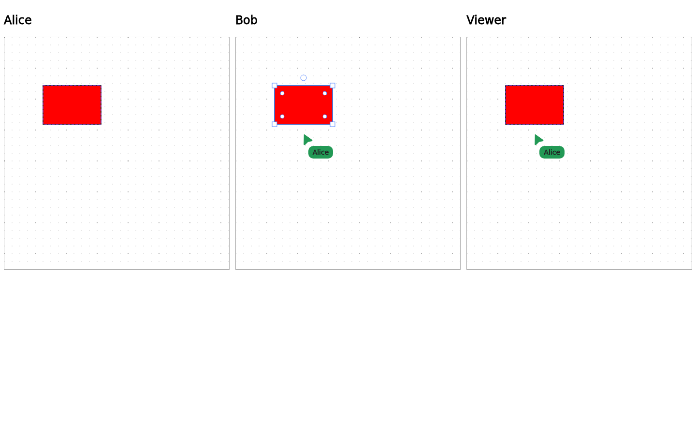

# Canvas multiplayer browser fixture

This fixture mounts three independent Canvas sessions (two editors and a viewer)
using the production Loro backend, session persistence contract, awareness adapter,
and graphics surface. An in-memory transport replaces hosted SyncService. It does
not mount the app shell or exercise hosted authentication.

From `apps/web`, run:

```sh
bunx playwright test --config src/features/block-canvas/browser-test/playwright.config.ts
```

The desktop case covers drag previews, cursors, remote selection and style,
local undo, session reopening, and peer departure. The touch case covers mobile
selection awareness. Each case runs only in its applicable device project.
Set `PLAYWRIGHT_CHROMIUM_EXECUTABLE_PATH` to use an installed Chromium.


